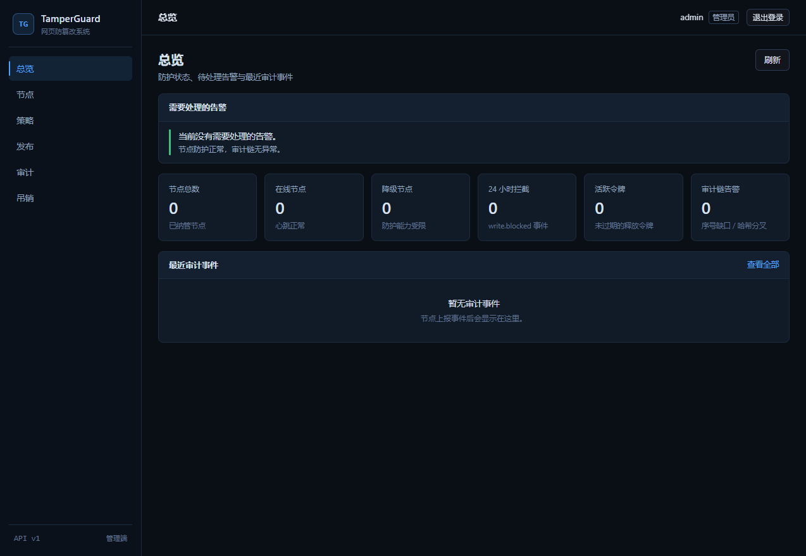
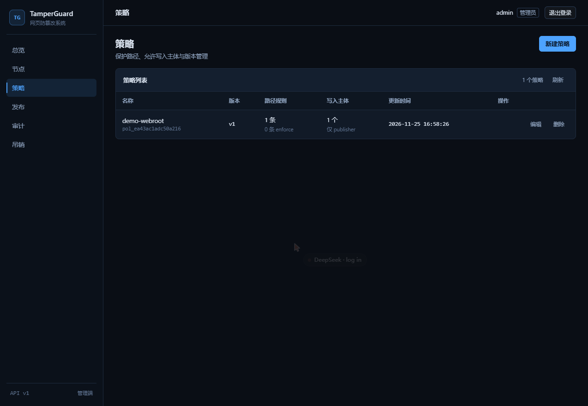

# TamperGuard

TamperGuard 是面向 Linux 主机的网页目录防篡改系统：内核层同步拒绝未授权写入，发布写入由内容哈希绑定的短时效令牌授权，所有写入行为进入可校验的链式审计。

先把边界写明：不防 root/管理员的**主动对抗**（但普通的管理员写入默认也会被拒，Linux 与 Windows 都是如此）；覆盖策略列出的路径；Linux 用 eBPF LSM 同步阻断（不可用时降级 fanotify 检测+回滚），Windows 用 NTFS ACL 锁定（无驱动，标记 degraded）；RASP 覆盖 Node.js 与 Java；发布支持本机与跨机（pull）两种形态。拿到 root/管理员权限的攻击者可以停执行层、改策略、删审计，本产品只能留下事后可检测的痕迹，不做“全面防护”。

## 核心设计

| 设计 | 做什么 | 不做什么 |
|---|---|---|
| 内容哈希绑定令牌 | 令牌绑定发布端身份、目标节点、路径范围与 release manifest 的 SHA-256 摘要，TTL ≤15 分钟，可吊销。令牌只证明“谁可以写”，manifest 摘要才证明“写的是批准的内容”。 | 不判断发布内容是否安全；发布端在提交 manifest 前被控制时，摘要绑定无法阻止恶意内容。 |
| 链式审计 | 每条记录带单调 seq、prev hash、自身 hash 与 Ed25519 签名；服务端按 Agent 追踪 `(next_seq, last_hash)`，出现缺口或分叉立即告警。 | 链式哈希只能发现修改；防删除靠 seq 与服务端缺口检测；拿到 Agent 私钥的 root 可伪造。 |
| 内核同步阻断 | eBPF LSM 在 open/write/create/unlink/rename/setattr/mmap 等原语进入前拒绝未授权写入，不是事后扫描。内核不支持或加载失败时回退 observe（不阻断，也不会自动记录真实写入），并标记 degraded。 | 不覆盖网络文件系统保证、容器 OverlayFS（P3 验证）、已打开 fd 之外的任意 root 行为；P0 的 fanotify 降级尚未实现（P2）。 |
| 跨平台执行层 | Windows 没有 eBPF/fanotify 对应物：默认严格模式：DACL 只给 SYSTEM 完全控制、Everyone 只读（**不授予 Administrators 写权限**），再叠加 **System + `NO_WRITE_UP`** 完整性标签——提权管理员（High 完整性）的普通写入也会被内核拒绝；只有发布窗口内临时降为 Medium 的路径才允许 `--publisher-sids` 账号通过 DACL 写入。管理员绕过（取得所有权/改标签）会在自愈扫描周期内被回滚并记 `tamper.restored`；Agent 以服务方式运行且服务 ACL 只允许 SYSTEM 停止。**已在真实 Windows 主机验证**：提权管理员覆盖/新建被拒、发布窗口授权与撤销生效、绕过修改被自愈还原；MIC 完整性标签为自检式可选增强（宿主不支持时自动禁用并注明）。执行层由平台自动选择，`tg-agent probe` 可查看结果。 | 挡不住管理员；拿不到每次写事件；第三方安全软件重置 ACL 后需要重新应用。先进路线（minifilter 驱动、完整性级别）见 [先进技术调研](docs/advanced-techniques.md)。 |
| 进程自保护 | `tg-agent landlock [--allow-write DIR] -- <web 进程>`：把 Web 服务放进只读沙箱，站点目录的写入/删除/重命名由内核直接拒绝（EACCES），即使该进程被 RCE 也改不了内容；不需要 root，也不需要 eBPF。 | 只能约束自身及其子进程；约束前已打开的 fd 不受限；被约束进程如果自己再 exec 也无法解除（设计如此）。 |
| 发布固化 | `--verity`：发布安装完成后对文件启用 fs-verity，文件变为内核级只读（写入 `EPERM`），读取按 Merkle 树校验（含 mmap），可对抗磁盘/固件级篡改。 | 需要内核 `CONFIG_FS_VERITY` 与文件系统 `verity` 特性；本机内核未启用，运行时验证待补。 |

## 架构

```
                         ┌──────────────────────────────────┐
  管理员 ──HTTPS──▶      │            tg-server             │
  （REST API）           │ 策略签名 · 令牌签发 · 审计验链    │
                         │ SQLite · mTLS · 15s 心跳          │
                         └───────┬──────────────────┬───────┘
                                 │ mTLS             │ mTLS
                                 │ 策略/心跳/审计     │ 发布申请/令牌
                                 ▼                  ▼
                    ┌────────────────────┐  ┌──────────────────┐
                    │  tg-agent          │  │   tg-publish     │
                    │  eBPF LSM 执行     │  │ 计算 manifest     │
                    │  observe 回退      │  │ 复核哈希后写入    │
                    │  审计链 / 心跳      │  │ 令牌只在内存      │
                    └─────────┬──────────┘  └────────┬─────────┘
                              │ hook 决策            │ 写本机 target_dir
                              ▼                      ▼
                    ┌──────────────────────────────────────┐
                    │ Linux 内核 VFS / LSM / 文件系统        │
                    │ 受保护路径：/var/www/site 等           │
                    └──────────────────────────────────────┘
```

## 管理端界面

登录后是六个页面（总览 / 节点 / 策略 / 发布 / 审计 / 吊销），零依赖原生页面，随二进制内嵌，不需要 Node 构建链。





## 快速开始（5 分钟）

环境：Linux 或 WSL2 Ubuntu 24.04，root，内核带 bpf LSM（`cat /sys/kernel/security/lsm` 含 `bpf`）。完整步骤、策略创建、发布与吊销验证见 [docs/quickstart.md](docs/quickstart.md)。

```bash
make build

# 初始化控制面：管理员密码与两个 bootstrap token 只打印一次
sudo ./bin/tg-server init --data-dir /var/lib/tamperguard
sudo ./bin/tg-server serve --data-dir /var/lib/tamperguard

# 另开终端：注册并启动受保护节点（token 来自上一步输出）
sudo ./bin/tg-agent enroll --server https://127.0.0.1:8443 \
  --bootstrap '<protect-token>' \
  --ca /var/lib/tamperguard/keys/ca.crt \
  --state-dir /var/lib/tamperguard-agent
sudo ./bin/tg-agent run --state-dir /var/lib/tamperguard-agent
```

没有 bpf LSM 时执行器回退 observe：写入不会被拒绝，真实写入也不会自动进审计。用户态全链路可以先跑 `sudo bash test/e2e/e2e-sim.sh`；内核带 bpf LSM 的机器跑 `sudo bash test/e2e/e2e-ebpf.sh` 验证真实阻断。

## 当前状态（P0）

> 执行层按平台与能力自动选择：Linux 为 eBPF LSM（同步阻断）→ fanotify（检测+回滚）→ observe，另可用 Landlock 给 Web 进程加“自缚”沙箱；Windows 为 ACL 锁定（实验性）。完整能力清单与验证矩阵见 [CHANGELOG](CHANGELOG.md) 与 [兼容性矩阵](docs/compat.md)。


| 状态 | 内容 |
|---|---|
| 已验证 | 核心库单测（token/policy/audit，覆盖篡改、删除、重放、过期、错误密钥）；控制平面（REST、SQLite、mTLS 注册、策略签名下发、心跳、审计验链）；保护端与发布端全链路；**eBPF LSM 真实阻断**：14 个 hook，`TestEBPFLSMEnforcement` 全部通过（受保护写入 EPERM、读放行、新建/删除被拒、令牌授权可写、撤权后再次被拒、阻断事件上报用户态、observe 规则只记录不阻断）；**新建子树保护继承**（`d_instantiate`，`TestEBPFInheritance`）：授权窗口内新建的目录/文件在内核里即时入索引并继承授权，撤销后无需等待重新同步立即受保护；内核级端到端 `test/e2e/e2e-ebpf.sh` 全部通过（WebShell 写入被内核拒绝 → 发布端凭令牌写入成功 → 吊销后 2 秒内写入被拒 → 审计链校验通过）；**SSE 推送通道**（策略/吊销/授权变更即时下发，心跳作兜底）；**授权传播确认**（发布端等节点确认 grant 已安装再写，失败回退重试）；mmap/mprotect 父目录判定、link 源与目标 inode、单文件规则的 unlink/rename 已补齐；性能基准（design §10.1.1：覆盖写 +13%、读 +1.25µs、新建 +18µs）；**fanotify 降级路径**（检测+回滚：覆盖写毫秒级回滚、新建/删除由周期巡检恢复、授权发布放行、降级节点需管理员审批），`test/e2e/e2e-fanotify.sh` 全部通过；**OverlayFS / 容器场景**（真实 overlay 挂载验证：写/建/删/改名/chmod 全拦、copy-up 后撤权仍拦、继承子树受保护）；部署形态（systemd / docker compose / K8s DaemonSet）；**process 写者规则映射到内核 uid**（策略变更即时生效，无需重启 agent）；**审计导出**（JSONL / CSV，带时间范围过滤）；**Agent 签名自升级**（Ed25519 manifest + SHA-256 校验 + 原子替换，篡改产物被拒）；**能力探测**（`tg-agent probe`，见 docs/compat.md）；**跨机发布（pull）**（发布端上传制品与签名清单，目标节点拉取、复核哈希后本机落盘，发布端不接触目标目录；篡改制品被拒）；**RASP（Node.js / Java）**（Unix socket 探针，观察优先、策略热切换、`rasp.observed`/`rasp.blocked` 进审计；Node 用 fs hook，Java 用 `-javaagent` + SecurityManager 文件权限检查）；GitHub Actions CI。 |
| 待完成 | 审计里新建文件的路径可能只回填 `inode:<号>`；5.10/6.1 内核兼容性未验证（当前只在 6.6 上验过）；fanotify 的队列溢出与崩溃窗口处理、超大文件树的增量巡检待补；审计保留周期与归档未实现。 |
| 未实现 | 规模化（Postgres、多节点压测、审计归档）；RASP 的 PHP 探针；Java 探针仅支持 JDK 16–21（SecurityManager 后续版本被移除）。 |

已验证的边界：eBPF 的 inode 匹配在普通本地文件系统（ext4/xfs/tmpfs）上有效，OverlayFS 容器场景已验证（copy-up 后仍受保护）。节点实际执行层以心跳上报的 `enforcer` 字段为准：`ebpf-lsm` 是内核同步阻断，`fanotify` 是检测+回滚，`windows-acl` 是 ACL 锁定，`observe` 表示没有阻断。Windows 被防护端为实验性能力（ACL 后端已实现并通过交叉编译与探针验证，尚未在 IIS 生产环境实测）。

复现验证：

```bash
sudo go test ./internal/enforcer -run TestEBPFLSMEnforcement -v   # 内核阻断单测
sudo bash test/e2e/e2e-ebpf.sh                                    # 内核级端到端
```

## 目录结构

```
cmd/tg-server/      控制面入口（init / serve / bootstrap-token）
cmd/tg-agent/       保护端入口（enroll / run）
cmd/tg-publish/     发布端入口（run）
bpf/                eBPF C 程序（tg_protect.bpf.c）与 vmlinux.h
internal/token/     发布令牌签发、校验、路径匹配
internal/policy/    策略模型、快照签名、决策函数
internal/audit/     审计链 Writer/Verifier/文件续链
internal/server/    控制面 HTTP API、鉴权、策略与审计处理
internal/store/     SQLite 持久化
internal/agent/     保护端运行时与 mTLS 客户端
internal/enforcer/  eBPF LSM 执行器、observe 回退、ringbuf 事件
internal/publish/   发布端 manifest、令牌与写盘
internal/config/    数据目录、密钥、Agent 状态
internal/idgen/     ID 生成
web/                管理端静态资源（编译时嵌入二进制，浏览器访问 https://<server>/）
test/e2e/           用户态、内核级、fanotify 降级、overlay 等 e2e 脚本
deploy/             systemd 单元 / docker compose / K8s DaemonSet
rasp/node/          Node.js RASP 探针（--require 加载）
rasp/java/          Java RASP 探针（-javaagent 加载，SecurityManager 权限检查）
docs/compat.md      内核与文件系统兼容性矩阵
docs/               design / threat-model / quickstart / api
Makefile            make build，产出 bin/ 下三个二进制
```

## 文档

- [技术设计](docs/design.md)：架构、信任模型、防护模型、内核 hook 矩阵、审计链、数据流、版本路线。
- [威胁模型](docs/threat-model.md)：资产、对手能力判定、发布通道滥用、降级与审计对抗、剩余风险、明确不做。
- [快速开始](docs/quickstart.md)：部署、策略、拦截验证、发布验证、吊销验证、常见问题。
- [HTTP API](docs/api.md)：REST 与 mTLS 接口合同。
- [兼容性矩阵](docs/compat.md)：内核、文件系统、RASP 运行时、TLS 证书。
- [不可变发布模式](docs/immutable.md)：只读镜像 + 滚动发布，以及它与文件级防护的配合方式（`deploy/k8s/immutable/`）。
- [Windows 部署](deploy/windows/README.md)：无驱动的服务安装、加固与局限。
- [Windows 部署管理端](docs/windows-server.md)：把控制面作为 Windows 服务安装（ProgramData 数据目录、防火墙、初始化凭据）。
- [Windows 更强方案评估](docs/windows-stronger-options.md)：CFA、事件驱动自愈、Web 层内容校验、VSS、不可变镜像的对比与选择。
- [Web 层内容校验](docs/web-verification.md)：tg-proxy 快照 + 逐请求校验，磁盘被改也交付可信内容。
- [用户手册](docs/user-manual.md)：安装、注册、策略、发布、运维、故障排查与安全边界（试点可用）。
- [Agent 生命周期](docs/agent-lifecycle.md)：管理端能力、两条卸载路径（管理端下发 / 客户端挑战-审批）、票据格式与安全边界。
- [用户手册（Word）](docs/TamperGuard用户手册_v0.2.2.docx)：可直接分发的排版版本（仿宋正文/黑体标题、A4、表格 11pt）。
- [变更记录](CHANGELOG.md)：能力清单、验证矩阵、已知限制。
- [安全策略](SECURITY.md)：漏洞报告渠道与威胁模型边界。
- [贡献指南](CONTRIBUTING.md)：构建、测试矩阵、代码结构、提交要求。

## 许可证

**PolyForm Shield License 1.0.0**（源码可见，非 OSI 开源许可）。

- 可以免费使用、修改、分发，包括在企业内部用于生产环境；
- 不得提供与 TamperGuard 竞争的产品或服务；
- 版权归作者 Vick 所有；商业授权/竞争场景请联系作者；
- 完整条款见 [LICENSE](LICENSE)，版权声明见 [NOTICE](NOTICE)。

Required Notice: Copyright 2026 Vick (https://github.com/easykeke/tamperguard)

## 变更记录

见 [CHANGELOG.md](CHANGELOG.md)。
